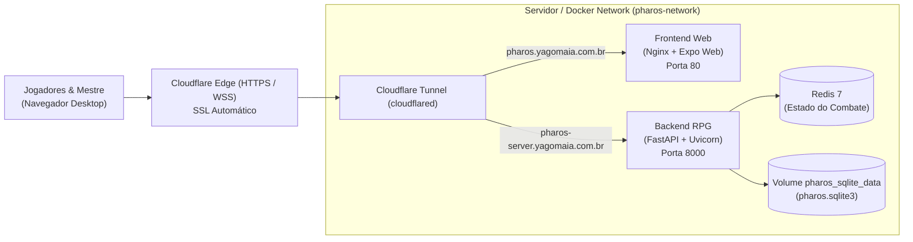

# Guia de Deploy com Docker e Cloudflare Tunnel

> **Domínios configurados:**
> - Frontend: `https://pharos.yagomaia.com.br`
> - Backend (API + WebSockets): `https://pharos-server.yagomaia.com.br`

---

## 1. Arquitetura dos Serviços



---

## 2. Configuração no Painel Cloudflare Zero Trust

1. No painel da Cloudflare, acesse **Zero Trust** > **Networks** > **Tunnels**.
2. Crie ou selecione o túnel para o servidor.
3. Copie o **Token do Túnel** fornecido pela Cloudflare.
4. Na aba **Public Hostnames** do túnel, cadastre as seguintes duas rotas:

| Public Hostname | Service Type | URL do Serviço | Observações |
|---|---|---|---|
| `pharos.yagomaia.com.br` | `HTTP` | `frontend:80` (ou `localhost:3000`) | Servidor web do frontend SPA |
| `pharos-server.yagomaia.com.br` | `HTTP` | `backend:8000` (ou `localhost:8000`) | API REST e WebSockets (`/ws/*`) |

> **Nota sobre WebSockets:** A Cloudflare suporta conexões WebSocket nativamente sobre a rota HTTP sem necessidade de configurações adicionais. O cliente conectará via `wss://pharos-server.yagomaia.com.br/ws/...`.

---

## 3. Subindo o Stack no Servidor

### Opção A: Stack Unificado (Frontend + Backend + Redis + Cloudflare Tunnel)

Na pasta raiz que contém ambos os repositórios clonados lado a lado:
```bash
pharos/
├── pharos_rp/           # Repositório do Frontend
└── pharos_rpg_server/   # Repositório do Backend
```

1. Acesse o diretório do frontend:
   ```bash
   cd pharos_rp
   ```

2. Crie o arquivo `.env`:
   ```bash
   cp .env.example .env
   ```
   Edite o `.env` e insira o seu `CLOUDFLARE_TUNNEL_TOKEN`:
   ```env
   CLOUDFLARE_TUNNEL_TOKEN=eyJhIjoi...
   EXPO_PUBLIC_API_URL=https://pharos-server.yagomaia.com.br
   ```

3. Suba o stack completo:
   ```bash
   docker compose -f docker-compose.full.yml up -d --build
   ```

---

### Opção B: Serviços Individuais

1. **Subir Backend & Redis:**
   ```bash
   cd pharos_rpg_server
   docker compose up -d --build
   ```

2. **Subir Frontend & Tunnel:**
   ```bash
   cd pharos_rp
   docker compose up -d --build
   ```

---

## 4. Persistência de Dados e Backups

* **Banco SQLite:** Armazenado no volume nomeado `pharos_sqlite_data` em `/data/pharos.sqlite3` no container do backend.
* **Estado do Redis:** Armazenado no volume `pharos_redis_data`.
* Para realizar backup do banco de campanhas do SQLite:
  ```bash
  docker cp pharos-backend:/data/pharos.sqlite3 ./backup_pharos.sqlite3
  ```
